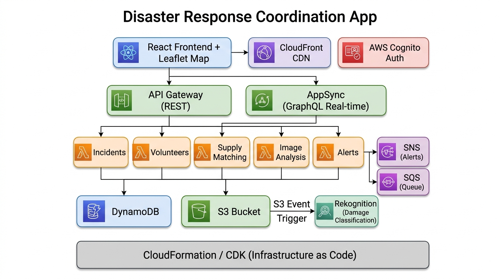

<p align="center">
  <h1 align="center">🆘 CrisisMesh — Disaster Response Coordination App</h1>
</p>

<p align="center">
  <a href="#"></a>
  <a href="#"></a>
  <a href="#"></a>
  <a href="LICENSE"></a>
</p>

<p align="center">
  A real-time, map-based platform connecting disaster victims, volunteers, and relief coordinators. Built entirely on a <strong>serverless AWS architecture</strong> spanning <strong>13 managed services</strong>, CrisisMesh enables rapid incident reporting with AI-powered damage classification, automated supply matching, and live situational awareness — all without provisioning a single server. Designed and developed as a semester project for a college Cloud Computing course.
</p>

---

## 📐 System Architecture



---

## ☁️ AWS Services Used

| # | Service | Purpose |
|---|---------|---------|
| 1 | **Amazon Cognito** | User authentication & role-based authorization (Victim / Volunteer / Coordinator) |
| 2 | **Amazon API Gateway** | REST API entry point with request validation & Cognito authorizer |
| 3 | **AWS AppSync** | GraphQL API with real-time WebSocket subscriptions for live map updates |
| 4 | **AWS Lambda** | Serverless compute for all backend business logic (Node.js 20) |
| 5 | **Amazon DynamoDB** | Single-table NoSQL database with geohash-based spatial queries |
| 6 | **Amazon S3** | Incident photo storage & static frontend hosting |
| 7 | **Amazon Rekognition** | AI-powered damage classification & severity assessment from uploaded images |
| 8 | **Amazon SNS** | Emergency alert fan-out broadcasting to subscribers |
| 9 | **Amazon SQS** | Decoupled supply-request / supply-offer matching pipeline |
| 10 | **AWS Amplify Hosting** | Frontend deployment with CI/CD and global CDN |
| 11 | **Amazon CloudWatch** | Centralized logging, metrics, and alarms |
| 12 | **AWS IAM** | Fine-grained least-privilege permissions for all services |
| 13 | **AWS CloudFormation / CDK** | Infrastructure as Code — entire stack defined in TypeScript |

---

## 📁 Project Structure

```
disaster-response/
├── backend/              # Lambda handlers
│   ├── handlers/
│   │   ├── incidents.ts        # CRUD for disaster incidents
│   │   ├── volunteers.ts       # Volunteer registration & dispatch
│   │   ├── supplyMatching.ts   # SQS-driven supply request/offer matcher
│   │   ├── imageAnalysis.ts    # Rekognition damage classification
│   │   ├── alerts.ts           # SNS emergency broadcast
│   │   └── auth.ts             # Cognito post-confirmation trigger
│   └── lib/
│       └── db.ts               # DynamoDB client & geohash utilities
├── frontend/             # React 18 + Vite + Leaflet.js
│   └── src/
│       ├── components/
│       │   ├── Auth.tsx           # Login / Sign-up forms
│       │   ├── Dashboard.tsx      # Statistics & overview
│       │   ├── MapView.tsx        # Leaflet live map with markers
│       │   ├── IncidentForm.tsx   # Report new incident
│       │   └── IncidentList.tsx   # Filterable incident feed
│       ├── api.ts                 # API client with Cognito auth headers
│       └── App.tsx                # Root component & routing
├── infra/                # AWS CDK (TypeScript)
│   ├── bin/
│   │   └── app.ts               # CDK application entry point
│   └── lib/
│       └── stack.ts             # Single-stack infrastructure definition
└── docs/                 # Architecture diagrams & documentation
    └── architecture.png
```

---

## 🛠️ Tech Stack

| Layer | Technology |
|-------|-----------|
| **Frontend** | React 18, Vite, Leaflet.js, OpenStreetMap tiles |
| **Backend** | Node.js 20, AWS Lambda, API Gateway (REST), AppSync (GraphQL) |
| **Database** | DynamoDB — single-table design with 4 GSIs |
| **Authentication** | AWS Cognito User Pools + Identity Pools |
| **AI / ML** | Amazon Rekognition (image label detection) |
| **Messaging** | Amazon SNS (pub/sub), Amazon SQS (queue) |
| **Infrastructure** | AWS CDK (TypeScript), CloudFormation |

---

## ✨ Features

- 📍 **Real-time incident reporting** — drop a pin on the map to report disasters with photos & descriptions
- 🤖 **AI-powered damage classification** — uploaded images are analyzed by Amazon Rekognition to auto-assign severity levels
- 📦 **Automated supply matching** — supply requests and offers are matched via an SQS-driven pipeline
- 🔐 **Role-based access control** — three roles (Victim, Volunteer, Coordinator) with granular permissions via Cognito groups
- 🚨 **Emergency alert broadcasting** — coordinators can push alerts to all subscribers via SNS
- 🗺️ **Live map with severity-coded markers** — Leaflet.js renders incidents with color-coded pins (🟢 Low → 🟡 Medium → 🔴 Critical)
- ⚡ **GraphQL real-time subscriptions** — AppSync WebSocket pushes live incident updates to all connected clients

---

## 📋 Prerequisites

| Tool | Version |
|------|---------|
| **Node.js** | 20+ |
| **AWS CLI** | v2, configured with `aws configure` |
| **AWS CDK CLI** | `npm install -g aws-cdk` |

> [!IMPORTANT]
> Ensure your AWS credentials are configured with sufficient permissions to create IAM roles, Lambda functions, DynamoDB tables, Cognito pools, and all other services listed above.

---

## 🚀 Quick Start

### 1. Clone the repository

```bash
git clone https://github.com/<your-org>/disaster-response.git
cd disaster-response
```

### 2. Install dependencies

```bash
# Backend
cd backend && npm install && cd ..

# Frontend
cd frontend && npm install && cd ..

# Infrastructure
cd infra && npm install && cd ..
```

### 3. Bootstrap CDK (first time only)

```bash
cd infra
npx cdk bootstrap aws://<ACCOUNT_ID>/<REGION>
```

### 4. Deploy the stack

```bash
cd infra
npx cdk deploy --outputs-file ../cdk-outputs.json
```

> [!NOTE]
> Deployment takes ~5 minutes. The outputs file will contain your API endpoint, Cognito Pool ID, AppSync URL, and S3 bucket name.

### 5. Configure the frontend

```bash
cd frontend
cp .env.example .env
```

Populate `.env` with the values from `cdk-outputs.json`:

```env
VITE_API_ENDPOINT=https://xxxxxxxxxx.execute-api.us-east-1.amazonaws.com/prod
VITE_COGNITO_USER_POOL_ID=us-east-1_XXXXXXXXX
VITE_COGNITO_CLIENT_ID=xxxxxxxxxxxxxxxxxxxxxxxxxx
VITE_APPSYNC_ENDPOINT=https://xxxxxxxxxx.appsync-api.us-east-1.amazonaws.com/graphql
VITE_S3_BUCKET=disaster-response-uploads-xxxx
```

### 6. Build & deploy the frontend

```bash
cd frontend
npm run build
aws s3 sync dist/ s3://<frontend-bucket-name> --delete
```

### 7. Open the app

Navigate to the **Amplify Hosting URL** or **CloudFront distribution URL** printed in the CDK outputs.

---

## 🔌 API Endpoints

All endpoints are prefixed with the API Gateway base URL and require a valid Cognito JWT in the `Authorization` header.

| Method | Route | Description | Auth Role |
|--------|-------|-------------|-----------|
| `POST` | `/incidents` | Create a new incident report | Any |
| `GET` | `/incidents` | List all incidents (with filters) | Any |
| `GET` | `/incidents/{id}` | Get incident by ID | Any |
| `PUT` | `/incidents/{id}` | Update incident status/details | Coordinator |
| `DELETE` | `/incidents/{id}` | Delete an incident | Coordinator |
| `POST` | `/incidents/{id}/image` | Upload image for AI analysis | Any |
| `POST` | `/volunteers` | Register as a volunteer | Volunteer |
| `GET` | `/volunteers` | List available volunteers | Coordinator |
| `PUT` | `/volunteers/{id}/assign` | Assign volunteer to incident | Coordinator |
| `POST` | `/supplies/request` | Submit a supply request | Victim |
| `POST` | `/supplies/offer` | Submit a supply offer | Volunteer |
| `GET` | `/supplies/matches` | Get matched supply pairs | Coordinator |
| `POST` | `/alerts` | Broadcast emergency alert via SNS | Coordinator |

---

## 🗄️ DynamoDB Data Model

### Single-Table Design

All entities live in one table (`CrisisMeshTable`) with composite keys and overloaded GSIs.

| Entity | PK | SK | Example |
|--------|----|----|---------|
| **Incident** | `INC#<id>` | `META` | `PK=INC#abc123, SK=META` |
| **Volunteer** | `VOL#<userId>` | `PROFILE` | `PK=VOL#user1, SK=PROFILE` |
| **Supply Request** | `SUP#<id>` | `REQ#<timestamp>` | `PK=SUP#xyz, SK=REQ#1700000000` |
| **Supply Offer** | `SUP#<id>` | `OFF#<timestamp>` | `PK=SUP#xyz, SK=OFF#1700000000` |
| **Alert** | `ALERT#<id>` | `META` | `PK=ALERT#n1, SK=META` |
| **Assignment** | `VOL#<userId>` | `ASSIGN#<incidentId>` | `PK=VOL#user1, SK=ASSIGN#abc123` |

### Global Secondary Indexes

| GSI | Partition Key | Sort Key | Purpose |
|-----|---------------|----------|---------|
| **GSI1** | `status` | `createdAt` | Query incidents by status (OPEN / IN_PROGRESS / RESOLVED) |
| **GSI2** | `geohash` | `severity` | Spatial queries — find nearby incidents by geohash prefix |
| **GSI3** | `type` | `createdAt` | Query by entity type across all records |
| **GSI4** | `assignedTo` | `createdAt` | Find all incidents assigned to a specific volunteer |

---

## 🧹 Cleanup

Remove all deployed AWS resources:

```bash
cd infra
npx cdk destroy
```

> [!CAUTION]
> This will permanently delete all DynamoDB data, S3 objects, Cognito user pools, and associated resources. Export any data you need before running this command.

---

## 📄 License

This project is licensed under the **MIT License** — see the [LICENSE](LICENSE) file for details.

---

## 👥 Team

| Name | Roll Number | Contribution |
|------|-------------|--------------|
| *Your Name* | *XXXX* | *Full-stack development, AWS architecture* |

---

<p align="center">
  Built with ❤️ for the Cloud Computing course<br>
  <sub>Powered by AWS Serverless</sub>
</p>
